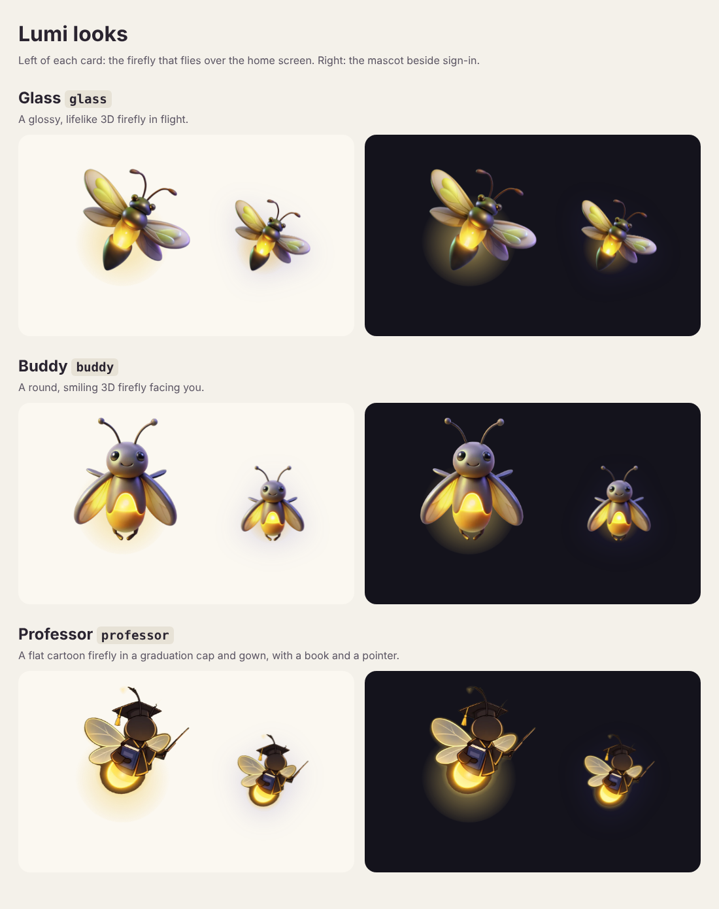

# lumi-looks (Claude Code plugin)

Changes how Lumi (Jugnu), the firefly tutor of [samajh.me](https://samajh.me), looks. Three looks
are included, and one command puts the original drawing back.



- Skill `lumi-looks`: how Lumi is drawn in the Samajh page, the looks, and the scripts that apply, preview and undo them.
- Command `/lumi-look <glass | buddy | professor | original | preview>`.

## Install

Put this folder in its own GitHub repository (for example `vivaanbhatla/lumi-looks-plugin`), then at the prompt of a Claude Code session:

```
/plugin install lumi-looks --marketplace vivaanbhatla/lumi-looks-plugin
```

To try it from a local folder instead:

```bash
claude --plugin-dir /path/to/lumi-looks-plugin
```

## Use

In a Claude Code session opened on the samajh.me repository:

```
/lumi-look preview
/lumi-look buddy
/lumi-look original
```

Or run the script yourself from the repository root (Node 18+, no dependencies):

```bash
node /path/to/lumi-looks-plugin/skills/lumi-looks/scripts/apply-look.mjs professor
```

## What changes

The firefly that flies over the home screen and the mascot beside sign-in. The glow still breathes
and the firefly still drifts; the wings no longer beat, because each look is a single picture. The
favicon, the dot avatar in Messages and Lumi's name are left alone.
